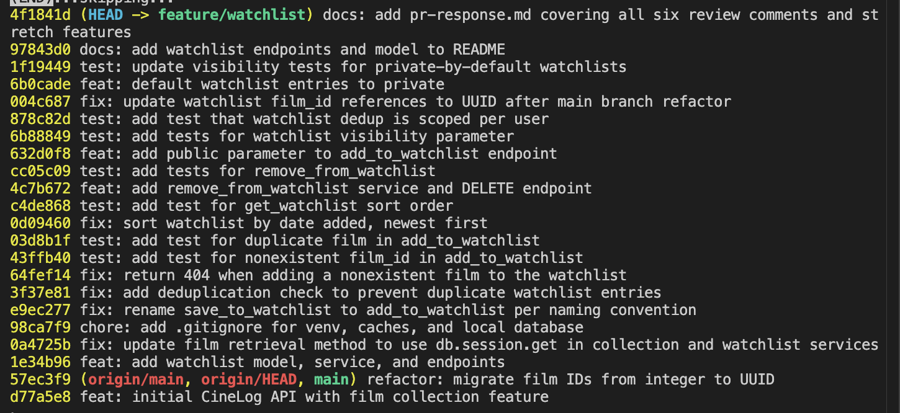

# PR Response Doc — CineLog Watchlist Feature

## AI Usage

I used Claude Code (an AI coding agent) on this project. Specifically:

- **Orientation.** It read `models.py`, `services/collection_service.py`, and `tests/test_collection.py` and walked through how `add_to_collection()` handles duplicates and missing films before any review comment was touched.
- **Pulling the review.** The six comments came from the upstream PR through the GitHub API, since forking doesn't copy the PR.
- **Code, tests, and commits.** It made the changes for Comments 1, 2, 3, and 6 and the three stretch features, ran `pytest` after every change, and smoke-tested the endpoints with curl against a freshly seeded database.
- **Checking the tests actually test something.** For the dedup test and the per-user test, it temporarily broke the service code to confirm each test fails when the bug is present (details under Comment 2 and the stretch section).
- **Drafts of Comments 4 and 5.** It wrote the first drafts of both design arguments below. Its Comment 4 draft argued for keeping `public=True`, leaning on CineLog being a community app and collections already being public. I disagreed. A watchlist feels personal to me, more like notes than a review, so I changed the position to private-by-default and had the code, tests, and doc updated to match. I kept the AI's Comment 5 position (date added, newest first) because I agree with it.


---

## Comment 1 — Rename

> `save_to_watchlist()` should follow the project's naming convention... Please rename to `add_to_watchlist()` and update all call sites.

**What I did:** Renamed `save_to_watchlist()` to `add_to_watchlist()` in `services/watchlist_service.py`. That makes it match `add_to_collection()` and the `verb_to_noun` rule in CONTRIBUTING.md.

**How I verified:** I ran a project-wide search for `save_to_watchlist` across all `.py` and `.md` files, excluding `.venv` and `.git`. It found three hits:

1. the definition in `services/watchlist_service.py`
2. the import in `routes/watchlist/watchlist.py`
3. the call inside `add_film()` in the same route file

All three were updated. A second search after the change returned nothing, and `pytest tests/` still passed. The test suite alone wouldn't have caught a missed call site, because no test imported the route at that point. That's why the search was the real check.

---

## Comment 2 — Deduplication

> What happens if a user calls this with a film that's already on their watchlist? The current implementation would add a duplicate entry.

**The pattern I followed:** `add_to_collection()` in `services/collection_service.py` does three things in order:

1. Looks the film up with `db.session.get(Film, film_id)` and raises `FilmNotFoundError` if it doesn't exist.
2. Queries `CollectionEntry.query.filter_by(user_id=user_id, film_id=film_id).first()`. The key point is that the duplicate check looks for an existing row for that **user + film pair**, not just the film.
3. If a row is found, it raises `AlreadyInCollectionError` and writes nothing. The route catches that and returns **409 Conflict** with the error message.

**What I did:** I mirrored that pattern exactly.
- Added an `AlreadyOnWatchlistError` exception next to the service, named the same way as `AlreadyInCollectionError`.
- In `add_to_watchlist()`, after the film-exists check, it queries `WatchlistEntry` for the same `user_id` + `film_id` pair and raises `AlreadyOnWatchlistError` if one exists.
- `POST /watchlist/<user_id>/add` catches it and returns 409, the same as the collection endpoint.

While I was in the route I found a second bug and fixed it in its own commit: the original endpoint had no `try/except` at all. Posting a film_id that doesn't exist raised `FilmNotFoundError` straight out of the view, which is a 500. It now returns 404, matching `/collection/<user_id>/add`.

**How I verified:**
- I added `test_add_to_watchlist_duplicate_raises`, modeled on `test_add_to_collection_duplicate_raises`. It adds the film twice, expects the error on the second add, and checks that only one row exists.
- To make sure the test really catches the bug, I swapped in the pre-fix service code and ran it. It failed with `DID NOT RAISE AlreadyOnWatchlistError`. With the fix restored it passes.
- Manually, the second `curl` POST of the same film returned `409` with `"Film '...' is already on this user's watchlist"`.

**Follow-up I didn't do:** `CollectionEntry` also has a database-level `UniqueConstraint("user_id", "film_id")`. `WatchlistEntry` doesn't. The app-level check covers normal use, but two simultaneous requests could both pass it. I left the constraint out of this PR because `db.create_all()` won't add it to existing tables, so it needs a real migration. I'd rather do that as its own change.

---

## Comment 3 — Missing test

> Please add a test for the case where `film_id` doesn't exist in the database.

**What I did:** Created `tests/test_watchlist.py` with `test_add_to_watchlist_nonexistent_film_raises`. It follows the same pattern as `test_add_to_collection_nonexistent_film_raises`:
- the same fixtures (`app` with an in-memory SQLite DB, `sample_user`, `sample_film`), copied over so the file stands alone like `test_collection.py`
- the same all-zeros UUID as the fake id
- the same `pytest.raises(FilmNotFoundError)` assertion

I added one extra assertion, `WatchlistEntry.query.count() == 0`. Raising the right error isn't enough on its own; I also wanted to prove nothing was written to the DB.

**How I verified:** `pytest tests/test_watchlist.py -v` passed, then `pytest tests/ -v` passed. This was before the UUID rebase, when film IDs were still integers. The fake id is a UUID string, so the test kept working unchanged after the rebase.

---

## Comment 4 — Default visibility

> I notice watchlists default to `public=True`. We don't have a documented decision on default visibility for user lists... I want to make sure we're being intentional here, not just inheriting a default.

**My position:** Watchlists should be private to the user by default. I changed the default to `public=False` in all three places it was set (the `WatchlistEntry.public` column default, the `add_to_watchlist()` argument, and the fallback in `POST /watchlist/<user_id>/add`), so they can't drift apart. Users who want to share a film can still pass `"public": true` (stretch feature below).

**Reasoning:**
- **A watchlist is personal.** It isn't a record of anything the user did. It's closer to a notes app or a bookmarks folder: films a friend mentioned, things you're curious about, maybe something you'd rather not explain. Nobody adds a film to a watchlist expecting it to be broadcast, so the safe assumption is that it's just for them.
- **Most people never change a default.** Whatever we pick here is effectively the setting for almost every entry. If the default is public, the people who get hurt are the ones who never thought to check, which is exactly the group a default is supposed to protect.
- **Private first is the reversible choice.** If we ship private and later decide sharing should be easier, we can add a "make my watchlist public" setting and nobody's data was ever exposed. If we ship public and later flip to private, every entry created in the meantime has already been visible. You can't take that back.
- **Sharing is still one flag away.** The new `public` parameter means a client can put a "share this" toggle on the add button. People who want their watchlist to be social can opt in, per film.

**Tradeoff acknowledged:** CineLog is described as "a community film tracking app," and private-by-default costs some of that community feel. Fewer watchlists will be visible, so there's less "see what your friends want to watch" discovery. Collections, by contrast, have no visibility setting at all: `GET /collection/<user_id>` shows anyone every film a user logged, with ratings. So watchlists will behave differently from collections. I think that difference is justified. A collection is a deliberate log of what you watched and how you rated it, closer to publishing a review. A watchlist is unfinished and personal. If the team decides discovery matters more, the opt-in toggle is the place to push it, through a clear "share" prompt in the UI, not a public default.

**Something the reviewer should know:** right now `public` is stored but not enforced. `GET /watchlist/<user_id>` returns every entry, private ones included, because CineLog has no auth yet. So "private" currently means "marked private," not "hidden." Once requests carry a user identity, the GET should return only `public=True` entries to anyone but the owner. That should be tracked as a follow-up before the UI promises users privacy.

---

## Comment 5 — Sort order

> I'd prefer watchlists to default to "date added" order rather than alphabetical. Most users want to see what they added recently.

**My position:** I agree, and I implemented it. `get_watchlist()` now orders by `WatchlistEntry.date_added` descending, so the newest entry comes first.

**Reasoning:**
- **How a watchlist gets used.** It's a queue that fills up from recommendations: a friend mentions a film, a trailer drops, you add it. The thing you just added is usually the one you're most excited about and most likely to watch next. Alphabetical order buries it somewhere in the middle.
- **Consistency.** `get_collection()` already sorts with `.order_by(CollectionEntry.date_added.desc())`. With both lists in the same order, a client can render a user's profile the same way for both, and nobody has to remember that one list is alphabetical and the other isn't.
- **Simpler query.** The old query joined `Film` only so it could sort by title. Sorting on the entry's own `date_added` drops the join, and the result matches the collection query line for line.

**Engagement with reviewer's point:**
- **Where I'd push past "most users want recent."** Alphabetical isn't worthless. Once a watchlist hits 50+ films, finding a specific title is easier in A–Z order. But that's a *search* problem, and it's better solved with a `?sort=title` query param or a title filter than by making it the default for everyone.
- **What I'd propose next.** A `sort` query param on `GET /watchlist/<user_id>` (`date_added` by default, `title` as the alternative). I kept it out of this PR so the review stays focused on what was asked.

**How I verified:** I added `test_get_watchlist_returns_newest_first`, modeled on `test_get_collection_returns_newest_first`. It uses "Alien" (added 5 days ago) and "Blade Runner" (added now). The titles are deliberately chosen so alphabetical order would give the opposite result. The test asserts `["Blade Runner", "Alien"]`.

---

## Comment 6 — Rebase

> A refactor merged to `main` that changed film IDs from integers to UUIDs. Your watchlist code still references integer IDs. Please rebase on `main` and update accordingly.

**What conflicted:** `git fetch origin && git rebase origin/main` stopped on the very first branch commit (the one that originally added the watchlist), with a conflict in `models.py` on one line, `WatchlistEntry.film_id`:
- `main` had changed it to `db.String(36)` as part of the UUID migration.
- My branch had added `index=True` to the old `db.Integer` version.

Both sides edited the same line, so git couldn't pick one.

**How I resolved it:** I kept both changes: main's type plus my branch's index.

```python
film_id = db.Column(db.String(36), db.ForeignKey("film.id"), nullable=False, index=True)
```

The index was a deliberate choice on the branch, and the type change is what the refactor was about, so dropping either one would have been wrong. The rest of the rebase replayed with no conflicts.

The conflict only covered the model. The watchlist code still described film IDs as integers in two places:
- the `add_to_watchlist()` docstring said `film_id (int) ... (Note: integer — pre-refactor)`
- the POST route docstring documented the body as `{ "film_id": <int> }`

I updated both to UUID strings in a separate commit: `fix: update watchlist film_id references to UUID after main branch refactor`.

**How I verified no conflict remains:**
- `grep` for `<<<<<<<`, `=======`, and `>>>>>>>` returned nothing.
- `grep -i` for `int>`, `(int)`, `integer`, and `pre-refactor` across the Python files left only the comments in `models.py` that describe the migration itself, plus unrelated integer columns (`year`, `rating`).
- `pytest tests/ -v`: 13 passed.
- `git log --merges --oneline` printed nothing, so the history is linear.
- I seeded a fresh database and ran the full add / duplicate / private / remove flow with curl using real UUID film IDs (see the manual testing steps below). Everything returned the expected status codes.

One thing to watch for locally: any `instance/cinelog.db` created before the rebase still has integer film IDs, and `db.create_all()` won't migrate it. Delete it and rerun `python seed.py`.

---

## Stretch — `remove_from_watchlist()`

`remove_from_watchlist(user_id, film_id)` follows `remove_from_collection()` line for line:
- It looks up the entry by the user + film pair.
- If there isn't one, it raises a new `NotOnWatchlistError`, named to match `NotInCollectionError`.
- Otherwise it deletes the entry, commits, and returns `True`.

It's exposed as `DELETE /watchlist/<user_id>/remove` with body `{"film_id": "<uuid>"}`. That returns 200 on success and 404 if the film wasn't on the list, the same shape as the collection remove endpoint.

Tests:
- `test_remove_from_watchlist_deletes_entry`: the happy path. The row is gone and the function returned `True`.
- `test_remove_from_watchlist_not_on_watchlist_raises`: removing something that was never added raises `NotOnWatchlistError`.

## Stretch — Second test (my choice of edge case)

`test_add_to_watchlist_same_film_different_users`: two different users each add the same film, and both adds succeed (2 rows).

**Why this case:** the dedup check from Comment 2 is only correct if it filters on **both** `user_id` and `film_id`. If someone later "simplifies" the query to `filter_by(film_id=film_id)`:
- the existing duplicate test still passes, because it only uses one user
- the result is that once anyone watchlists Paddington 2, nobody else can

That's an easy mistake to make and a bad one to ship. I confirmed this test is the one that catches it: I temporarily removed `user_id` from the filter, and this was the only test of the 13 that failed.

## Stretch — Visibility toggle

`add_to_watchlist()` now takes a `public` keyword argument (default `False`), and `POST /watchlist/<user_id>/add` accepts an optional `"public"` field in the body. Leaving it out keeps the private default from Comment 4. Passing `"public": true` is how a user opts in to sharing.

The endpoint rejects anything that isn't a real JSON boolean with a 400. I specifically wanted to catch clients sending `"public": "false"` as a string: Python treats `"false"` as truthy, so without the check that request would silently save a *public* entry, the exact opposite of what the user asked for. With private as the default, that bug would quietly expose something the user meant to hide.

Tests:
- `test_add_to_watchlist_defaults_to_private`
- `test_add_to_watchlist_public`: passing `public=True` stores a shared entry.
- `test_add_endpoint_rejects_non_boolean_public`: hits the route through Flask's test client and checks for a 400 and zero rows written.

---

## Commit history



<!-- TODO (me): replace git-log.png with my screenshot of `git log --oneline` -->

Text copy of `git log --oneline origin/main..HEAD` before this doc was committed:

```
97843d0 docs: add watchlist endpoints and model to README
1f19449 test: update visibility tests for private-by-default watchlists
6b0cade feat: default watchlist entries to private
004c687 fix: update watchlist film_id references to UUID after main branch refactor
878c82d test: add test that watchlist dedup is scoped per user
6b88849 test: add tests for watchlist visibility parameter
632d0f8 feat: add public parameter to add_to_watchlist endpoint
cc05c09 test: add tests for remove_from_watchlist
4c7b672 feat: add remove_from_watchlist service and DELETE endpoint
c4de868 test: add test for get_watchlist sort order
0d09460 fix: sort watchlist by date added, newest first
03d8b1f test: add test for duplicate film in add_to_watchlist
43ffb40 test: add test for nonexistent film_id in add_to_watchlist
64fef14 fix: return 404 when adding a nonexistent film to the watchlist
3f37e81 fix: add deduplication check to prevent duplicate watchlist entries
e9ec277 fix: rename save_to_watchlist to add_to_watchlist per naming convention
98ca7f9 chore: add .gitignore for venv, caches, and local database
0a4725b fix: update film retrieval method to use db.session.get in collection and watchlist services
1e34b96 feat: add watchlist model, service, and endpoints
```

The original first commit message, "added watchlist model and endpoint fixed a bug more changes", was reworded with `git rebase -i`. The "fixed a bug" part (switching to `db.session.get`) already lived in its own commit, so the first commit really is a single logical change and only needed a new message. No merge commits.

---

## PR Description

### What this does
Adds a watchlist to CineLog so users can save films they want to watch later, alongside the collection of films they've already watched. Users can add a film (private by default, or shared if they choose), view their watchlist newest-first, and remove films. A film can only be on a given user's watchlist once.

### Design decisions
- **Watchlists are private by default.** A watchlist is personal, most users never change defaults, and starting private is the choice we can loosen later without exposing anyone. Callers pass `"public": true` to share an entry. Note that private entries aren't hidden from the GET yet, since there's no auth. Filtering them for non-owners is a follow-up. Full reasoning is in `pr-response.md` (Comment 4).
- **Sort order is date added, newest first.** This matches how people use a watchlist (recent additions are what you watch next) and matches `get_collection()`. A `?sort=title` option is a reasonable follow-up for long lists. See `pr-response.md` (Comment 5).

### Endpoints
| Method | Endpoint | Notes |
|---|---|---|
| GET | `/watchlist/<user_id>` | Newest first |
| POST | `/watchlist/<user_id>/add` | `{"film_id": "<uuid>", "public": true}` (public optional, default false); 201 / 400 / 404 / 409 |
| DELETE | `/watchlist/<user_id>/remove` | `{"film_id": "<uuid>"}`; 200 / 404 |

### How to test manually
1. Set up and seed a fresh database. If you have an `instance/cinelog.db` from before the UUID refactor, delete it first.
   ```bash
   rm -f instance/cinelog.db
   python seed.py          # prints the demo user_id
   python app.py
   ```
2. In another terminal, grab IDs:
   ```bash
   USER=<user_id printed by seed.py>
   curl -s localhost:5000/films/        # copy two film ids
   FILM=<Alien's id>; FILM2=<Spirited Away's id>
   ```
3. Add a film. Expect **201** with `"public": false` (private by default).
   ```bash
   curl -i -X POST localhost:5000/watchlist/$USER/add -H 'Content-Type: application/json' -d "{\"film_id\":\"$FILM\"}"
   ```
4. Add the same film again. Expect **409** "already on this user's watchlist".
5. Add a second film as shared. Expect **201** with `"public": true`.
   ```bash
   curl -i -X POST localhost:5000/watchlist/$USER/add -H 'Content-Type: application/json' -d "{\"film_id\":\"$FILM2\",\"public\":true}"
   ```
6. Send `"public": "false"` as a string. Expect **400**.
7. Add `00000000-0000-0000-0000-000000000000`. Expect **404**.
8. `curl -s localhost:5000/watchlist/$USER` should list Spirited Away first (added most recently), then Alien.
9. Remove Alien. Expect **200**. Remove it again and expect **404**.
   ```bash
   curl -i -X DELETE localhost:5000/watchlist/$USER/remove -H 'Content-Type: application/json' -d "{\"film_id\":\"$FILM\"}"
   ```
10. `pytest tests/ -v` should show 13 passing.
